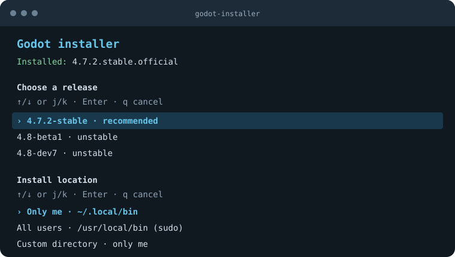

<h1> Godot installer</h1>

Installs Godot on Linux with interactive version and location selection,
checksum verification, and an application launcher.

Requires Bash, `curl`, `jq`, `unzip`, and GNU coreutils.

```sh
bash -c "$(curl -fsSL https://raw.githubusercontent.com/trflorian/godot-installer/main/install.sh)"
```


